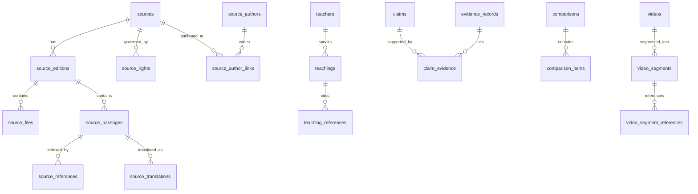

# Database Schema, ERD & Flyway Plan

Database engine: **Neon PostgreSQL** with `pgcrypto` (UUIDs), `pg_trgm` / PostgreSQL Full-Text Search (English & Devanagari support), and `pgvector` (for vector embeddings).

---

## 1. Global Database Conventions

1. **Dual Identifiers:** Every public-facing entity has an internal `BIGSERIAL` primary key `id` (fast joins) AND a non-sequential `UUID public_id DEFAULT gen_random_uuid() UNIQUE NOT NULL` exposed in APIs/URLs to prevent enumeration/IDOR.
2. **Printed vs. PDF Page Separation:** `printed_page_label` (e.g., `"42"`, `"xii"`) and `pdf_page_number` (`INTEGER`) are always distinct columns.
3. **Original vs. Translated Separation:** `source_passages.original_text` is immutable once verified; translations reside in `source_translations`.
4. **Timestamps as Integer Seconds:** Video segment boundaries use `start_seconds INTEGER NOT NULL`, `end_seconds INTEGER NOT NULL` with `CHECK (end_seconds > start_seconds)`.
5. **Status & Audit Columns:** Core records carry `status`, `created_at`, `updated_at`, `created_by`, `updated_by`, and `version INTEGER`.
6. **Zero Secrets in DB:** No API keys, DB passwords, or private tokens in any table.
7. **Schema Changes Strictly via Flyway:** `ddl-auto: validate` in Spring Boot; all schema evolution in `backend/spring-boot-app/src/main/resources/db/migration/`.

---

## 2. Logical Entity Groups (34 Tables)

### Flyway Migration Sequence

| Migration | Group | Tables |
|---|---|---|
| `V1__extensions_and_identity.sql` | Extensions & Identity | Extensions (`pgcrypto`, `pg_trgm`, optional `vector`), `users`, `roles`, `permissions`, `user_roles`, `role_permissions`, `user_collections`, `user_bookmarks` |
| `V2__sources_and_rights.sql` | Sources & Editions | `sources`, `source_editions`, `source_files`, `source_rights`, `source_authors`, `source_author_links` |
| `V3__passages_and_translations.sql` | Scriptures & Passages | `source_passages`, `source_references`, `source_translations`, `passage_relationships`, `glossary_terms` |
| `V4__teachings_library.sql` | Teachings | `teachers`, `teachings`, `teaching_references` |
| `V5__claims_evidence_comparisons.sql` | Research & Claims | `topics`, `claims`, `evidence_records`, `claim_evidence`, `comparisons`, `comparison_items` |
| `V6__videos_and_segments.sql` | Video Library | `videos`, `video_segments`, `video_segment_references` |
| `V7__review_audit_contributions.sql` | Governance & Public | `review_tasks`, `verification_reviews`, `content_versions`, `audit_logs`, `public_submissions`, `copyright_reports`, `correction_reports` |
| `V8__ai_ingestion_and_vectors.sql` | Ingestion & AI | `ingestion_jobs`, `processing_jobs`, `embedding_records`, `ai_requests`, `retrieval_logs`, `ai_evaluations`, `provider_usage_logs` |

---

## 3. Key Table Constraints & Indexes

- **`source_references`:** Stores flexible hierarchy (`hierarchy_level_1..4` such as `Mandal/Sukta/Mantra` or `Surah/Ayah` or `Book/Chapter/Verse`) + `canonical_ref_key` indexed for exact reference lookup (`O(log N)` B-Tree).
- **`source_passages`:**
  - `language_code` (`en`, `hi`, `sa`, `ar`, `pa`, etc.)
  - `text_layer_type` (`ORIGINAL_TEXT`, `PUBLISHED_TRANSLATION`, `COMMENTARY`)
  - `extraction_confidence` (`NUMERIC(5,2)`), `ocr_flag BOOLEAN`
  - GIN index on `to_tsvector('simple', coalesce(original_text, ''))` + trigram GIN index for Devanagari & romanized Hindi matching.
- **`evidence_records`:**
  - `relationship_type` (`SUPPORTING`, `CONTRADICTING`, `CONTEXTUAL`, `NEUTRAL`, `INCONCLUSIVE`)
  - `source_edition_id` (`NOT NULL`), `language_code` (`NOT NULL`), `status` (`CHECK` constraint on the 9 valid states).
- **`embedding_records`:**
  - `passage_id` (FK), `chunk_index`, `chunk_text`, `context_before`, `context_after`, `embedding VECTOR(768)` (or configurable dimension), `is_published_eligible BOOLEAN` (must be `true` only when parent passage & source are `PUBLISHED`).
- **Publication Constraint:** Public views/queries filter `status = 'PUBLISHED'`; database check constraints ensure `published_at` and `verified_by` are non-null whenever `status = 'PUBLISHED'`.

